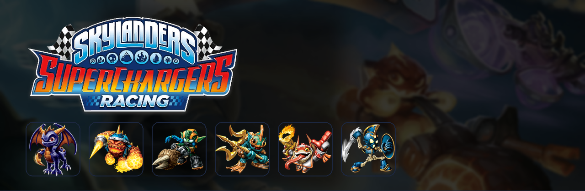
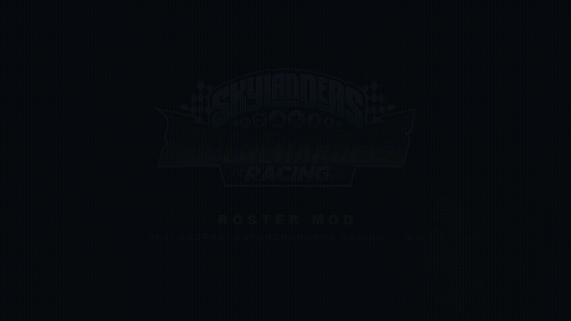
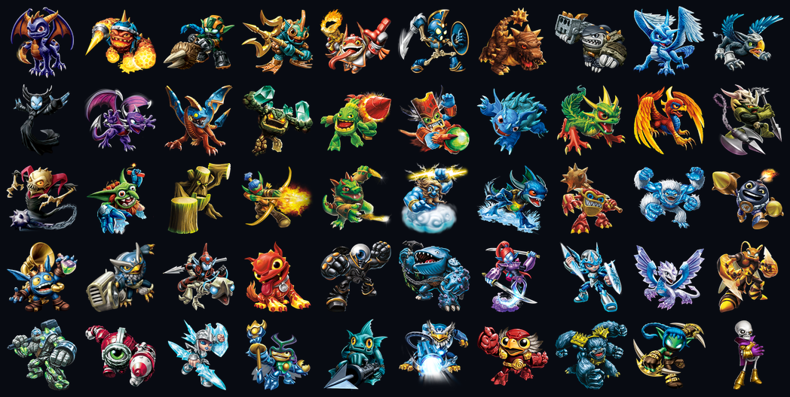

# Skylanders: SuperChargers Racing (Wii) — roster mod + launcher



Tooling and a desktop launcher for modding **Skylanders: SuperChargers Racing**
(Wii, game id `SKNE52`) *inside the disc's own `.pkz` containers*, plus the notes
from working out how the engine stores racers.

The game ships **71 racer slots** — 56 driver records and 12 villain records, one
per terrain (air / land / sea), plus 3 `Greeble*Info` test dummies — and every
slot is two object refs: the **character** and the **vehicle** it drives. This
repo rewrites the character ref of each slot in place, so the container keeps its
exact size and the disc keeps loading.

## What it does

| | |
|---|---|
| **Random cast** | every boot fields a different set of opponents: `launcher/` rolls a cast over the disc's 224 catalogue figures and patches the 71 slots, then repacks the image (~10 s) |
| **Stats for every figure** | `tools/pkz_stats_patch.py` fills in all 203 character stat records — 148 of them ship as empty stubs — with one spiked spread per figure: every figure gets the same three points and spends them very differently, so no two drive alike |
| **Random cups** | `tools/pkz_cup_random.py` re-points the three cup playlists at a fresh order of the disc's own circuits |
| **Launcher** | a tkinter window: PLAY (roll + patch + repack + boot), pin figures, netplay session codes for two-machine split-screen, export to an SD card layout for a real Wii |
| **Your Skylander** | the figure *you* race as comes from the Portal of Power, not the pkz — the launcher installs the chosen 1024-byte tag image into the emulated portal and enables it in Dolphin |

## The 3DS build

The 3DS romfs is the same game data in a little-endian, zlib-wrapped container
(`tools/pkz_3ds.py` reads it), and the stats mod ports onto it:

```sh
python3 tools/pkz_3ds_stats.py <dump>/romfs/0004000000165E00/Data/BaseSkylander.pkz \
    --out 3ds/titles/0004000000165E00/romfs/Data/BaseSkylander.pkz \
    --compare disc/files/Data/BaseSkylander.pkz
```

Same scheme, same 3.0 budget, same archetypes - and 198 of the 203 figures come
out with the **same spread the Wii build's patch gives them**. The file keeps its
exact size, and the result is laid out for Luma's layeredfs, so the romfs needs
no repack: copy `3ds/titles/...` over your SD card's `luma/titles/...`.

The opponent cast is not ported yet - the 3DS build has no `RacerAIInfo` records
to recast where this reader can see them, and its online mode's endpoints live in
its executable, not in the romfs. `FINDINGS.md` has both.

The multiplayer data, though, is the same on both builds. Comparing them with
`tools/pkz_diff_builds.py`: all ten of the 3DS build's cup and multiplayer playlist
records are identical to this disc's pristine line-up, and 441 of the 479
multiplayer-related names read out of the 3DS build already exist somewhere in the
Wii data tree. The 41 that do not are its own screen furniture - bottom screen,
3DS tour track select, toy select, online signal strength - plus a few name
variants. So nothing on the data side would change what the mode does.

## Promo clip

[](promo/promo.mp4)

32 seconds, silent preview above — the real thing with sound is
[`promo/promo.mp4`](promo/promo.mp4) (4 MB). The art is the disc's own; the
soundtrack is a music cue cut out of `Streams2.dat` with
[SSCR-Audio-Tool](https://github.com/Gopooo/SSRC-Audio-Tool).
`tools/make_promo.py` renders it, and
[`promo/README.md`](promo/README.md) documents which stream was used, why, and
how to re-render or swap the music.



Fifty of the **224 figures** the disc's toy catalogue knows — the pool a race is
rolled from. Every image above is the game's own artwork, pulled out of the
`.pkz` files by `tools/extract_art.py` and composed by
`tools/make_readme_images.py`; nothing here is drawn or mocked up.

Documented in [`FINDINGS.md`](FINDINGS.md) (the engine findings, including the
attempts that broke the disc and why) and [`launcher/README.md`](launcher/README.md)
(launcher usage, platforms, netplay).

## What is in the repo — and what is not

Committed: the Python tools, the launcher, the shell front ends, the findings,
and the promo clip. **Not** committed (see `.gitignore`): the extracted disc
(`disc/`), the pkz baselines (`backups/`), the rebuilt `*.wbfs`, extracted text
(`text/`), the fetched `wit` (`tools/wit/`), and the artwork the launcher draws
with — all of that is extracted from a disc you own. The composed files in `docs/`
and `promo/` are the exception, so the README can show what the mod looks like.

## Setup

You need: Python 3.9+ with tkinter, `pip install -r requirements.txt` (Pillow),
Dolphin to play, and [Wiimms ISO Tool](https://wit.wiimm.de/) (`wit`) to
unpack/repack the image. Nothing else is downloaded for you, and **you need your
own copy of the disc**.

```sh
python3 setup.py --check                 # what is still missing on this machine
python3 setup.py /path/to/your/game.iso  # unpack, make the baselines, build the image
./run.sh                                 # Windows: run.cmd
```

`setup.py` is the whole install: it finds `wit` and Dolphin, unpacks the image
into `disc/`, copies the four pristine `.pkz` baselines the patcher works from
into `backups/`, pulls the game's own portraits/minimaps out of the disc for the
window, and repacks `skylanders-scr-mod.wbfs`. Re-running it is safe — it only
does the steps that are missing, and `--force` rebuilds the image and the
artwork.

It takes a `.iso`, `.wbfs` or `.wia`.

`wit` is the one thing setup downloads: if it is not on `PATH`, in `tools/wit/`
or in a `DolRecomp` checkout next to this folder, the official build
(wit.wiimm.de, v3.05a) is fetched into `tools/wit/` and ad-hoc signed on macOS —
that folder is git-ignored. `python3 setup.py --fetch-wit` does just that step,
and `--no-fetch` refuses to download anything. Same for Dolphin: `DOLPHIN=` and
`WIT=` override auto-detection.

Without Dolphin you can still patch and export for a real Wii; without `wit`
nothing can be unpacked or repacked, and `setup.py` says so before it starts.

`reroll.sh` and `cups.sh` do the same rolls and repack from a shell, without the
window. The launcher expects the Skylander tag dumps (1024-byte `.sky` images)
in `../skylanders-nfc-sim/data`; without them the roster side still works, only
the portal picker is empty.

## If it does not start

| what you see | what to do |
|---|---|
| `tkinter is missing` | Debian/Ubuntu `sudo apt install python3-tk`, Fedora `sudo dnf install python3-tkinter`, Windows: reinstall Python from python.org with **tcl/tk** ticked |
| `Pillow is missing` | `python3 -m pip install -r requirements.txt` |
| `wit NOT FOUND` | install Wiimms ISO Tool, put `wit` on `PATH`, or `WIT=/path/to/wit` |
| `no such disc image` | `setup.py` wants the image file itself, not a folder; `.iso`, `.wbfs` and `.wia` all work |
| the window opens but PLAY does nothing | run `python3 setup.py --check` — it names the missing piece |
| no picture in Dolphin on macOS | Dolphin's Metal backend cannot build this disc's vertex pipelines; `play-mod.sh` and the launcher force the OpenGL backend instead |
| the portal picker is empty | the toy library (`../skylanders-nfc-sim/data`) is not next to this folder — optional, only that picker needs it |

## Doing it by hand (the way this repo was built)

`setup.py` only automates this. These are the steps, in this order, with the
tool I actually used: **Wiimms ISO Tool v3.05a r8638**, the copy that came with
the DolRecomp checkout at `../DolRecomp/extern/wit/bin/wit` — nothing had to be
installed for it.

```sh
WIT=../DolRecomp/extern/wit/bin/wit      # or WIT=/path/to/wit, or put wit on PATH

# 1. unpack the disc
$WIT extract "/path/to/Skylanders SuperChargers Racing.iso" disc
ls disc/files/Data/BaseGameplay.pkz

# 2. keep a known-good pair before touching anything
mkdir -p backups
cp disc/files/Data/BaseGameplay.pkz  backups/BaseGameplay.pkz.pristine
cp disc/files/Data/BaseGameplay.pkz  backups/BaseGameplay.pkz.working-randomcast
cp disc/files/Data/BaseSkylander.pkz backups/BaseSkylander.pkz.pristine
cp disc/files/Data/Common.pkz        backups/Common.pkz.pristine

# 3. look before you patch
python3 tools/pkz_objects.py disc/files/Data | head -20
python3 tools/pkz_objects.py disc/files/Data --name _AIInfo | wc -l      # 60 racer records
python3 tools/pkz_objects.py disc/files/Data --name DriverPeacock --refs
```

The objects are printed as `file  name  id  size  fields`; `--refs` resolves the
32-bit ids in each record to the object they point at, which is how a racer's
character and vehicle refs were found — in `DriverPeacock_Land_AIInfo` the three
refs read *character, AI template, vehicle* plus the terrain byte at the end.

Then the mod, one change at a time, repacking and verifying after each:

```sh
python3 tools/pkz_random_bots.py        # recast the 71 racer slots in place
python3 tools/pkz_stats_patch.py        # real racing stats for every character (BaseSkylander.pkz)
python3 tools/pkz_cup_random.py --print # show a cup line-up, then drop --print to write it
python3 tools/extract_art.py            # the game's own portraits for the window

$WIT copy disc skylanders-scr-mod.wbfs --overwrite
$WIT verify skylanders-scr-mod.wbfs | tail -1     # must read +OK ... SKNE52
```

Do not trust the repack alone — check that the file inside the image is the one
you patched:

```sh
md5 -q disc/files/Data/BaseGameplay.pkz
$WIT extract skylanders-scr-mod.wbfs /tmp/check
md5 -q /tmp/check/files/Data/BaseGameplay.pkz     # same hash
```

Boot it:

```sh
./play-mod.sh           # = Dolphin -v ogl -e skylanders-scr-mod.wbfs
```

Four things cost me time; they are worth knowing before you hit them:

* **`-v ogl` is not optional on macOS.** Dolphin's Metal backend cannot build
  this disc's vertex pipelines and dumps `bad_pipeline_Metal_*.txt` to
  `~/Library/Application Support/Dolphin/Dump/`. It looks exactly like a broken
  image.
* **A downloaded `wit` needs a signature.** The build from wit.wiimm.de is
  linker-signed; on arm64 macOS the kernel kills it (signal 9) until you run
  `codesign --force --sign - tools/wit/bin/wit`.
* **Every edit has to keep the file size.** The `.pkz` key registry is a hash
  index, so adding an object shifts offsets and the game hangs on load. Compare
  `ls -l` before and after, and `wit verify` after the repack.
* **A racer has two refs** (character and vehicle). Re-point the character and
  leave the vehicle alone; giving a villain its own hull is what produced
  corrupt racers (`FINDINGS.md`, "A racer's two refs").

Undo any of it by copying the pristine pair back and repacking:

```sh
cp backups/BaseGameplay.pkz.pristine disc/files/Data/BaseGameplay.pkz
cp backups/Common.pkz.pristine       disc/files/Data/Common.pkz
$WIT copy disc skylanders-scr-mod.wbfs --overwrite
```

## Layout

```
setup.py      one-command install: unpack, baselines, artwork, image
run.sh        start the launcher (run.cmd on Windows)
launcher/     the window: session roll, patch, repack, launch, netplay, export
  roster.py       the 71 racer slots out of BaseGameplay.pkz
  pipeline.py     session codes + build/launch/export
  toys.py         tag library, portal folder, Dolphin's portal settings
  assets.py       joins the figure catalogue to the extracted art
  sessions.py     UDP announce/discover for the session browser
  platforms.py    per-OS Dolphin/wit paths, fonts, video backend
tools/        the pkz readers/writers (see below)
docs/         banner.png + roster.png + promo.gif, composed from the disc's own art
promo/        promo.mp4 and how it was made
FINDINGS.md   what the engine does, with the evidence
reroll.sh     roll a cast and repack
cups.sh       roll the cup line-ups and repack
play-mod.sh   start Dolphin on the built image (OpenGL backend forced on macOS)
```

## License

MIT (see [`LICENSE`](LICENSE)) — for the code in this repo. No game files are
included or distributed here, and none are downloaded.

The two images in `docs/` are the game's own artwork, included only to show what
the mod does; the art itself remains © Activision and is not covered by that
license.

## The tools

The docstring at the top of each one explains the format it reads or writes; the
`argparse` ones take `--help`, the older scripts print their usage when run with
no arguments (`python3 tools/pkz_objects.py`).

| | |
|---|---|
| `pkz_objects.py` | parse a `.pkz`, list its objects and resolve the 32-bit ids they reference — start here |
| `pkz_refs.py` | the per-object reference tables (the character/vehicle refs live here) |
| `pkz_random_bots.py` | recast the 71 racer slots as a random cast (what the launcher runs) |
| `pkz_stats_patch.py` | give every character its own racing stats — a spiked spread per figure, same 3.0 total; fills the 148 empty stat records |
| `pkz_cup_random.py` | re-point the three cup playlists at the disc's own circuits |
| `pkz_pool_swap.py` | move villains into the driver pools without resizing anything |
| `extract_art.py` | pull portraits, minimaps and menu backgrounds out as PNG |
| `make_readme_images.py` | compose `docs/banner.png` and `docs/roster.png` out of that art |
| `make_promo.py` | render `promo/promo.mp4`: game art, game music, one ffmpeg pipe |
| `pkz_textures.py` | list/export every texture in a container |
| `pkz_3ds.py` | read the 3DS build's containers (little-endian, zlib-wrapped) — used to settle what the 4-player mode needs |
| `pkz_3ds_stats.py` | the stats mod, ported to the 3DS romfs: same spreads on 198 of 203 figures, written back at the same size |
| `pkz_diff_builds.py` | compare a data file between the disc and the 3DS build, then test the 3DS's names against all 786 Wii files - how the 4-player and online question was settled |

The rest (`pkz_ai_add`, `pkz_ai_append`, `pkz_pool_grow`, `pkz_pool_all`,
`pkz_pool_fill`, `pkz_add_test`, `pkz_pool_terrain`, `pkz_text_scan`,
`pkz_stats_scan`, `pkz_bind`) are the probes used to work out the container, and
the experiments that did not work out. They are kept because `FINDINGS.md` cites
them; several of them shift offsets and hang the game, so do not run them on a
tree you care about.

[`TIERLIST.md`](TIERLIST.md) ranks all 182 figures best to worst from the stats
`pkz_stats_patch.py` writes, in tiers cut from the roster into fifths — with the
weights spelled out, since every figure totals the same 3.0 and the order depends
on what you value.

## Notes

- Every edit is **same-size**: the disc's key registry is a hash index, so adding
  objects shifts offsets and the game hangs. `FINDINGS.md` has the details.
- A racer has two refs. Swapping the character is safe; re-pointing a villain at
  its own hull is not, and is what produced corrupt racers. Villain records stay
  on the terrain's `RentAWreck_*` rental, which the Greeble dummies already use.
- The game's own multiplayer is 2P split-screen, and going to the 3DS's four
  players is a **code** limit, not a data one: the Wii disc already ships the 4P
  splitscreen object and the player-3/4 UI art, while the part that decides how
  many local players join lives in `gamelogic.rso`. `FINDINGS.md` has the
  comparison against the 3DS build, read with `tools/pkz_3ds.py`.
- The disc's online half is not switched off but **absent**: `GLAPINetwork` is never
  constructed, there is no `PAGE_MultiOnline_*` page, and the Wii's own online auth
  (Nintendo WFC) had already been shut down before this game shipped. Online play
  today means Dolphin netplay over the shipped split-screen - the launcher's PLAY
  WITH A FRIEND - not the game's netcode.
- No game files are distributed here. You need your own disc.
